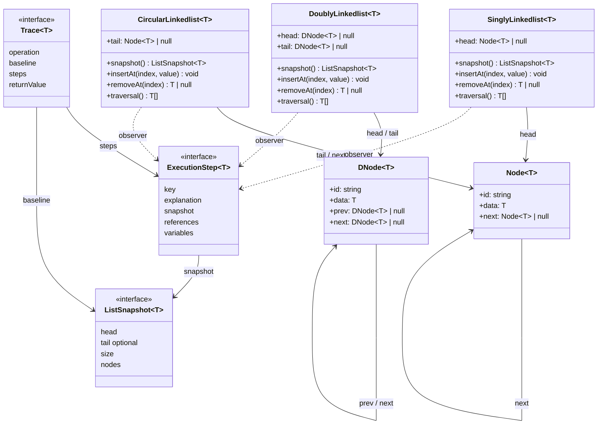
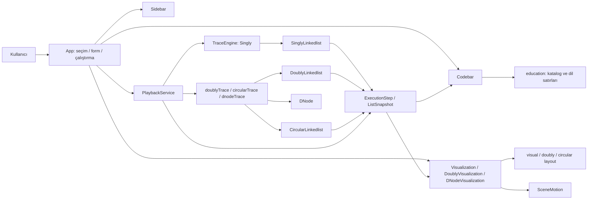
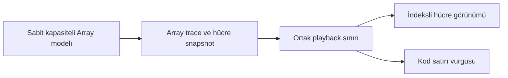
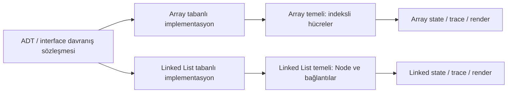
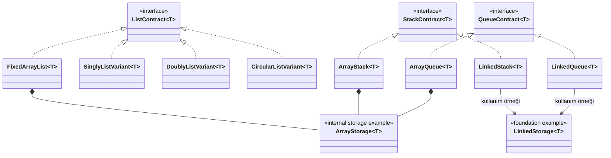
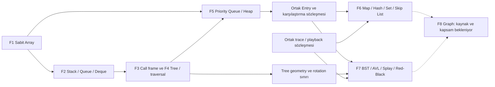

# UML — mevcut uygulama ve taslak sınırlar

2026-11-16 kaynak envanteri. Diyagramlar mevcut kaynak ilişkilerinin özetidir; eksiksiz API için [API](API.md), öneri için [mimari](planning/ARCHITECTURE.md) ve [plan](planning/PROJECT_PLAN.md). Aşağıdaki taslak açıkça ayrılmıştır.

## Mevcut sınıflar

Diyagram yalnız örnek işlemleri gösterir; üç liste 18 işlemi uygular. Circular `head` saklamaz; snapshot head'i `tail.next` projeksiyonudur. Generic Node, Array önkoşulu değildir. Dönüşler doğrudan değerlerdir; `Result` sınıfı yoktur.

## Mevcut modüller ve akış

Trace üretimi işlem başında çalışma kopyasında yapılır; player kayıtları cursor ile oynatır. Reset baseline'a döner; tamamlanmamış işlem iptali başlangıcı geri yükler. `PlaybackService` üç listeye ait ayrı kalıcı snapshot tutar. Kod anahtarları, görsel ve açıklama aynı adımla ilerler.

## Taslak — Array entegrasyonu

Bu bölüm yalnız öneridir: sınıf adı, işlem kümesi, kapasite giriş modeli ve kesin trace sözleşmesi henüz onaylanmadı veya uygulanmadı; somut kapasite ve işlem önerisi [planda](planning/PROJECT_PLAN.md) yer alır. Array Node ve linked-list snapshot alanlarına zorlanmaz. Sonraki ADT'ler [kaynak haritasında](planning/SOURCE_MAP.md) incelenir; kapsam kararı ve bağımlılıklar netleşmeden mevcut sınıf olarak çizilmez.

## TASLAK — ADT ve temsil sınırları

Bu kavramsal modül diyagramı [DEC-0038](../DECISIONS/engineering/DEC-0038-foundations-and-interfaces.md) yönünü gösterir; yeni sınıf, kalıtım veya kesin API uygulandığı anlamına gelmez. ArrayList sabit kapasitelidir; Java'nın dinamik ArrayList sınıfı değildir.

Bu ayrım composition/delegation ile kurulabilir; bu somut mekanizma öneridir, kullanıcı kararı veya mevcut kod iddiası değildir. Mevcut iki Node ve üç liste sınıfı yukarıdaki mevcut diyagramda gösterilir; Array uygulanmamıştır.

## TASLAK — koşullu interface ve depolama örneği

Bu yalnız `ArrayList` teriminin bağımsız List implementasyonu olarak seçilmesi halinde incelenecek örnektir; seçenek henüz kararlaştırılmadı. Stack ve Queue örnekleri de kapsam onayı değildir. Diyagram kavramsal realization ve depolama kullanımını gösterir; kaynakta bu interface veya sınıfların varlığını iddia etmez. Fiziksel Array ayrı public sınıf olmak zorunda değildir.

İsimler ve ilişkiler taslaktır; tüm ADT'lere List işlemleri veya aynı kalıtım zinciri zorlanmaz. Queue'nun circular hücre ihtiyaçları packed ArrayList kullanımına bağlanmaz.

## TASLAK — ders fazlarının bağımlılıkları

Aşağıdaki modüller gelecekteki önerilerdir; uygulanmış sınıflar, onaylanmış kapsam veya evrensel bir üst sınıf olarak yorumlanmamalıdır. Ayrıntılı kaynak ve sınırlar [kaynak haritasında](planning/SOURCE_MAP.md) yer alır.

F6 ve F7, ortak Entry, trace ve gerekli layout sınırları sabitlendikten sonra ayrı dosya sahipliğiyle paralel hazırlanabilir. Ortak registry ve playback entegrasyonu tek yazarda kalır. Graph okları yalnız kaynak ve kapsam bekleyen gelecek değerlendirmeyi gösterir; bu konunun tüm bağımlılıklarını veya onayını ifade etmez. AVL ve Red-Black silme için mevcut kaynaklarda tam işlem izi yoktur.

## Kontrol kaydı

2026-11-16: Kaynak dosyalarından mevcut Node, DNode, üç liste, trace, playback ve görselleştirme ilişkileri yeniden yazıldı. Önceki tarihsel taslaklar güncel sınıf gibi gösterilmedi. Bu belge çalıştırma veya test kanıtı değildir; önceki doğrulama için [VALIDATION](VALIDATION.md).
