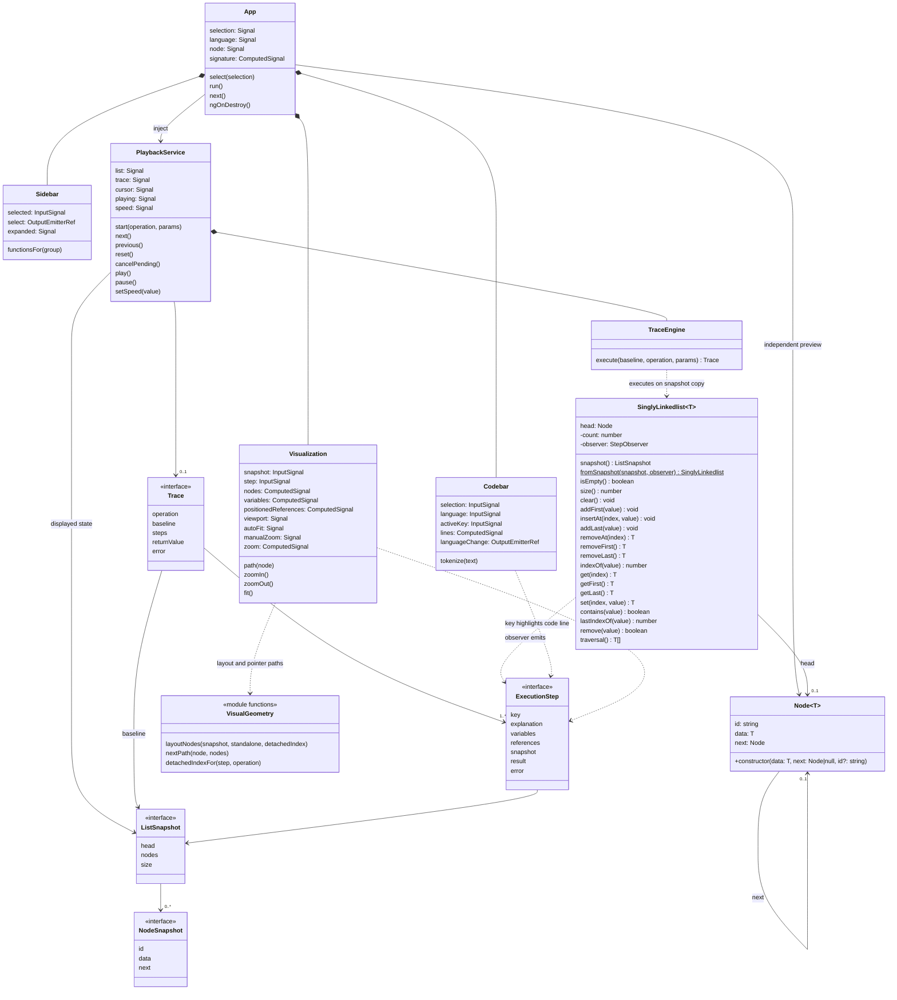
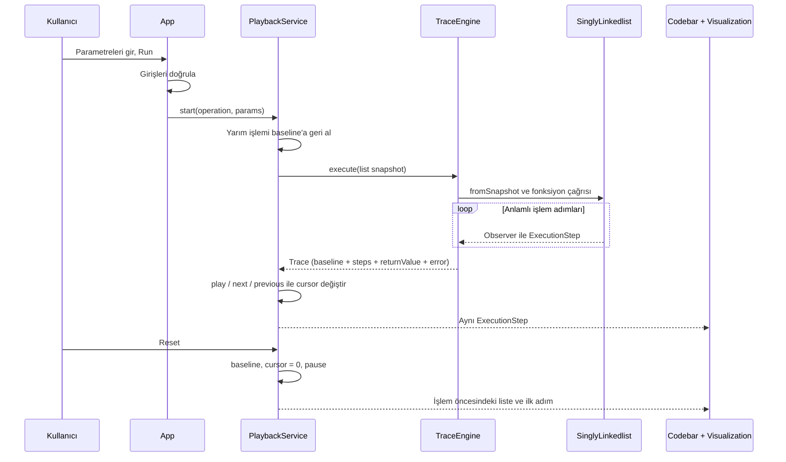

# UML diyagramı

## Durum

2026-10-12: Bu diyagram artık çalışan kaynak kodu yansıtır. Angular ekranı TypeScript sınıflarını çalıştırır; Java/C örnekleri aynı işlem davranışını öğretir. Array henüz uygulanmadı.

## Sınıflar ve ilişkiler

Fonksiyonlar doğrudan değer döndürür. TypeScript'te data dönüşleri T | null, Java'da T, C'de const char * olarak gösterilir. Trace.returnValue yalnızca dönen değeri saklar; error ayrı açıklamadır. Node listeye veya Angular'a bağımlı değildir. id görsel kimliktir, bellek adresi değildir. Liste head ve count tutar; tail saklanmaz.

## Bir işlemin ilerleyişi

Fonksiyon değişimi tamamlanmamış işlemi iptal eder; tamamlanan işlemin listesi korunur. Completed adımından Previous Step ile geri dönülmüşse fonksiyon değişimi yine o işlemin baseline'ına döner.

## Kaynak eşleştirmesi

- `src/app/core/node.ts`: bağımsız Node.
- `src/app/core/singly-linkedlist.ts`: algoritmalar ve observer.
- `src/app/core/execution.types.ts`: snapshot, step, trace ve result sözleşmeleri.
- `src/app/core/trace-engine.ts`: işlemi kayda dönüştürme.
- `src/app/core/playback.service.ts`: ortak liste, oynatma ve geri alma.
- `src/app/components/`: Sidebar, Codebar, Visualization.
- `src/app/education/`: fonksiyon kataloğu ve Java/C/sözde kod satır eşleştirmeleri.

## Kontrol kaydı

- 2026-10-12: Kavramsal taslak oluşturuldu.
- 2026-10-12: Bağımsız Node ve API fonksiyon kapsamı eklendi.
- 2026-10-12: Angular ilk uygulaması, TraceEngine, PlaybackService, gerçek modeller ve panel component'leriyle güncellendi. İleri/geri oynatma ve iptal ilişkileri eklendi.
- 2026-10-12: Kod örnekleri export/doğrulama script'leri ve tests eklendi; uygulama sınıf ilişkilerini değiştirmediği kontrol edildi.

- 2026-10-12: Son HTML biçimlendirmesi, test düzeltmesi ve doğrulama dokümanları sonrası UML ilişkileri gözden geçirildi; sınıf ilişkilerinde değişiklik yok.

- 2026-10-12: Yerel başlatma adresi ve sunucu temizliği kaydı gözden geçirildi; UML ilişkileri değişmedi.

- 2026-10-12: Yerel sunucunun yeniden başlatılması sonrası kontrol edildi; kaynak kod ve UML ilişkileri değişmedi.

- 2026-10-12: Result kaldırıldı; doğrudan dönüşler, App.signature, VisualGeometry modülü, zoom ve viewport alanları gerçek kodla eşleştirildi. Çalıştırma alanı Codebar altında App tarafından yönetilir.

- 2026-10-12: Node id etiket konumu, next eğrisi alt şeridi ve C/Pseudocode Node çağrı imzası güncellendi; sınıf ilişkileri değişmedi.

- 2026-10-12: Zoom sahne wrapper’ı ve CSS scale geçişi eklendi; Visualization sınıf ilişkileri değişmedi.

- 2026-10-12: Sonuç kadrajı ve boş liste adım açıklaması güncellendi; model/component ilişkileri değişmedi.

- 2026-10-12: Codebar görünür satır kaydırma hesabı ve referans tooltip’leri kontrol edildi; UML ilişkileri aynı.

- 2026-10-12: Son doğrulama/screenshot kayıtlarıyla birlikte kontrol edildi; diyagram güncel gerçek kaynak yapısını yansıtıyor.

- 2026-10-13: Node constructor next parametresini açıkça alır; Java/C/Pseudocode örnekleri aynı sözleşmeyi kullanır. Ekleme adımlarını korumak için başlangıçta null gönderilir.

- 2026-10-13: UI yerleşimi gözden geçirildi: App üst barı seçili dosyanın breadcrumb’ını gösterir; ayrı workbench-heading kaldırılmıştır. Codebar yalnız dil seçimi ve IDE’yi sunar; method kartı App içinde aşağıdadır. Visualization içindeki execution-summary, değişken ve açıklama kartlarını 1:3 yan yana gruplar. Mevcut component ilişkileri değişmedi.

- 2026-10-13: Git başlangıcı sırasında UML gözden geçirildi; sürüm kontrolü uygulama sınıflarını veya ilişkilerini değiştirmedi.
